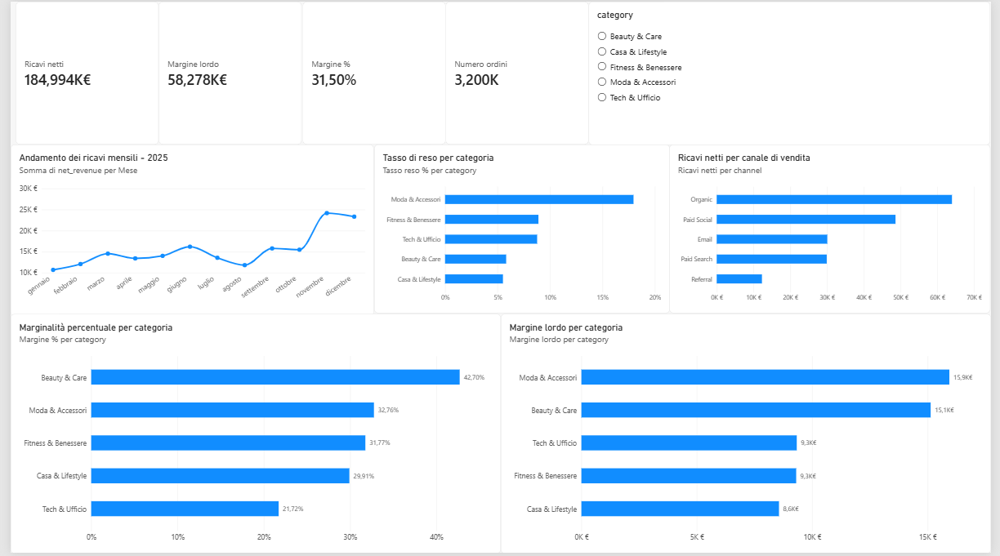

# E-Commerce Sales Analytics

### End-to-End Data Analytics Project | Python · PostgreSQL · Power BI

## Project Overview

This project explores an end-to-end data analytics workflow applied to an e-commerce business scenario.

The objective is to transform transactional data into meaningful business insights, combining programming, database analysis, and interactive data visualization.

## Technologies & Skills

- **Python:** Data generation and analytical workflows.
- **PostgreSQL & SQL:** Relational data management, aggregation, and business KPI analysis.
- **Power BI:** Interactive dashboards and visual reporting.
- **Data Analytics:** Revenue analysis, profitability, sales trends, and business performance measurement.

## Project Files

| File | Description |
|---|---|
| `genera_dataset.py` | Python script for generating sample data |
| `Ecommerce_analysis.pbix` | Power BI report |
| `README_GUIDA_PASSO_PASSO.md` | Step-by-step project documentation |

The SQL analysis scripts will be added to the repository as the documentation is completed.

## Business Questions

The project is designed to investigate:

1. How do sales and revenue evolve over time?
2. What is the relationship between net revenue and gross profit?
3. Which KPIs are most useful for monitoring business performance?
4. How can interactive dashboards support data-driven decisions?

## Analytical Workflow

1. Generate a sample e-commerce dataset using Python.
2. Organize transactional data in a PostgreSQL database.
3. Perform exploratory analysis and calculate business KPIs using SQL and Python.
4. Visualize the results through an interactive Power BI dashboard.
5. Interpret the findings from a business perspective.

## Future Improvements

- Upload the SQL scripts and analytical queries.
- Add dashboard screenshots.
- Document key numerical results and business insights.
- Expand the analysis with statistical and predictive models.

## Power BI Dashboard

The dashboard provides an interactive overview
of e-commerce sales performance, including
revenue trends and profitability metrics.

## Key Business Insights

The analysis of the synthetic e-commerce dataset highlights several business performance patterns:

**1. Overall profitability**

The business generated approximately €185K in net revenue and €58K in gross profit, corresponding to an overall gross margin of 31.5%.

**2. Revenue evolution**

Monthly revenue fluctuated throughout 2025, with a noticeable increase during the final months of the year. This suggests that investigating possible seasonal effects could be valuable.

**3. Product category performance**

Beauty & Care achieved the highest percentage gross margin (approximately 42.7%), while Fashion & Accessories generated one of the largest absolute gross profit contributions.

**4. Sales channel performance**

Organic traffic represented the largest revenue contribution, followed by Paid Social. These findings provide a starting point for evaluating channel performance and marketing effectiveness.

**5. Returns analysis**

Fashion & Accessories recorded the highest return rate among the analyzed categories, suggesting an opportunity to investigate potential causes and their impact on profitability.

## Potential Business Recommendations

- Investigate the factors driving higher revenues toward the end of the year.
- Evaluate opportunities to expand high-margin product categories.
- Examine return patterns in Fashion & Accessories.
- Combine revenue data with marketing expenditure to assess channel efficiency and return on investment.

*Note: This project uses synthetic data for educational and portfolio purposes. The findings illustrate analytical methods rather than actual company performance.*

## Author

**Urmila Bosisio**

PhD Researcher in Applied Mathematics

Interested in Data Science, Advanced Analytics, Machine Learning, and Mathematical Modeling.
